<div align="center">



<a href="https://git.io/typing-svg">
  
</a>

<br/>


<br/><br/>

<a href="https://portfolio-ouahid.vercel.app"></a>
<a href="https://linkedin.com/in/abdelouahid-kherchache"></a>
<a href="mailto:wahidkherchache@gmail.com"></a>
<!-- <a href="https://github.com/wahidkherchache"></a> -->

<br/><br/>


</div>

<br/>

---

## 🔴 About Me

```yaml
name: "Abdelouahid Kherchache"
role: "Junior Computer Engineer"
university: "USTHB — University of Science and Technology Houari Boumediene"
location: "Baba Hassen, Algiers, Algeria"
```

Full-Stack Developer and final-year Computer Science student at USTHB (Algiers), specializing in software engineering. Ive been working as a Junior Software Engineer at Black and Yellow since August 2026, building production web applications end to end. On the front end, I work with Next.js, React, and TypeScript. On the back end, I build APIs with Nest.js and Node.js, backed by PostgreSQL (with Prisma ORM) and MongoDB.


 
## 🔴 Tech Stack

**Languages**
<p>  </p>

**Front-End**
<p>  </p>

**Back-End & Databases**
<p>  </p>

**Cloud, DevOps & Tooling**
<p>  </p>

<p>


</p>

**Design**
<p>  </p>

---

## 🔴 Security & Networking Focus

<div align="center">

| Domain | Proficiency | Details |
|---|:---:|---|
| Web Application Security | 🔴🔴🔴⚪⚪ | OWASP Top 10, XSS, CSRF, SQL Injection, security headers |
| Networking Fundamentals | 🔴🔴🔴🔴⚪ | Core networking concepts, Linux/CMD comparative administration |
| Web Pentesting | 🔴🔴⚪⚪⚪ | Building toward bug bounty participation |
| Databases & SQL | 🔴🔴🔴⚪⚪ | Oracle SQL, relational design |

</div>

---


## 🔴 Featured Work

<details open>
<summary><b>🎨 E-Learning Platform — System Design in Figma</b> · <i>Delivered</i></summary>
<br/>

Complete design of an e-learning platform: the whole website, all pages, delivered in Figma and handed over to the client.

| | |
|---|---|
| **Scope** | Full website — every page, user flows and component system |
| **Tool** | Figma |
| **Status** | ✅ Delivered |

</details>

<details>
<summary><b>🚀 Production CMS Deployment on a Client VPS</b></summary>
<br/>

Took a multi-service headless CMS from local development to a real production VPS owned by the client, using Docker Swarm and Dokploy.

| | |
|---|---|
| **Frontend / Admin** | Next.js (standalone Docker output) |
| **API** | NestJS |
| **Database** | MongoDB as a replica set (transactions required) |
| **Cache / Rate limiting** | Redis |
| **File storage** | MinIO (S3-compatible) behind a File Manager service |
| **Proxy + TLS** | Traefik + Let's Encrypt |
| **Access** | WireGuard VPN, SSH |

```text
Visitor --HTTPS--> Traefik --> Website | Dashboard | API | MinIO (signed links)
                                              API --> MongoDB, File Manager --> MinIO, Redis
```

Only Traefik is exposed. Databases, Redis and internal services stay on the internal Docker network.

</details>

---

## 🔴 What I Learned — Deployment & DevOps

<details>
<summary><b>🐳 Docker & Networking</b></summary>
<br/>

- Services talk to each other by **service name**, never `localhost`; services on different networks cannot see each other.
- Debugged a container-only `Connection reset by peer` caused by an **MTU mismatch** (1442 vs 1500). Fixed with TCP **MSS clamping** (`iptables`), persisted with `netfilter-persistent`.
- Swarm `host`-mode published ports bypass the `DOCKER-USER` chain — always verify firewall rules with packet counters instead of assuming they work.

</details>

<details>
<summary><b>🔐 Configuration & Secrets</b></summary>
<br/>

- `NEXT_PUBLIC_*` variables are baked at build time: changing them needs a **rebuild**, not a restart.
- Runtime secrets never go into an image; secrets shared by two services must be byte-identical, all others unique per environment and per client.
- Anything that appears in a screenshot or log is exposed and must be rotated.

</details>

<details>
<summary><b>🔎 Debugging Method</b></summary>
<br/>

- Read the exact log line — each error points at one layer: `WRONGPASS` (Redis), `ENOTFOUND` (DNS/network), `InvalidAccessKeyId` (storage key), `self-signed certificate` (TLS not issued yet), `Not authenticated` (service token / allowed IP).
- Split the system into layers and test each alone: DNS → port → TLS → proxy → app → database.
- Prove it before blaming someone else's network: packet counters and `tcpdump`.

</details>

<details>
<summary><b>🗄️ Data, Storage, TLS & DNS</b></summary>
<br/>

- MongoDB **replica set** is mandatory when the API uses transactions.
- S3-style storage serves downloads through **presigned URLs**: the storage service needs a public domain with a valid certificate, and the signed hostname can't change afterwards.
- Let's Encrypt (HTTP-01) needs port 80 open and correct DNS; mind the per-domain rate limits.

</details>

<details>
<summary><b>⚙️ Build Resources & Operations</b></summary>
<br/>

- Building Next.js/Nest images on a small machine: one build at a time, with swap; measure the real minimum heap before lowering `NODE_OPTIONS`.
- Traefik JSON access logs + `logrotate` (30+ days); daily backups (`mongodump` + storage volume), 7-day retention, plus an **off-server copy** and a tested restore.
- Admin ports (SSH, platform panel) reachable only through a VPN.

</details>

---

## 🔴 Contribution Snake

<div align="center">
<picture>
  <source media="(prefers-color-scheme: dark)" srcset="https://raw.githubusercontent.com/wahidkherchache/wahidkherchache/output/github-contribution-grid-snake-dark.svg" />
  
</picture>
</div>

---

## 🔴 Connect With Me

<div align="center">

<a href="mailto:wahidkherchache@gmail.com"></a>
<a href="https://linkedin.com/in/abdelouahid-kherchache"></a>
<!-- <a href="https://github.com/wahidkherchache"></a> -->
<a href="https://wahidkherchache.github.io/Portfo/"></a>

</div>

---

<div align="center">

*"Code with purpose, secure with intent."*


</div>
